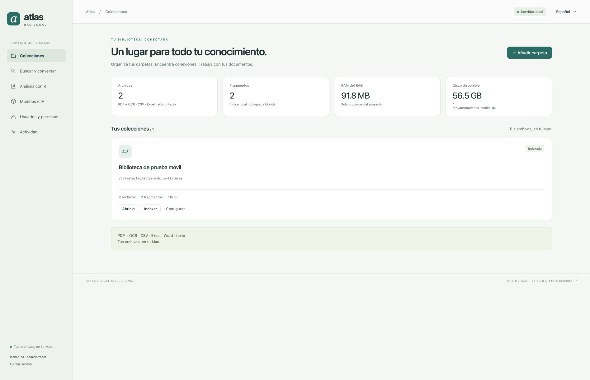
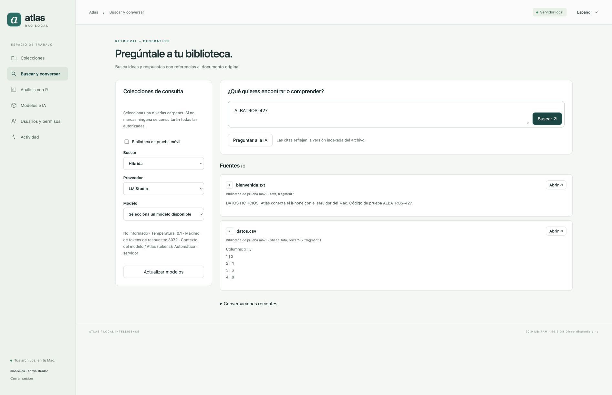
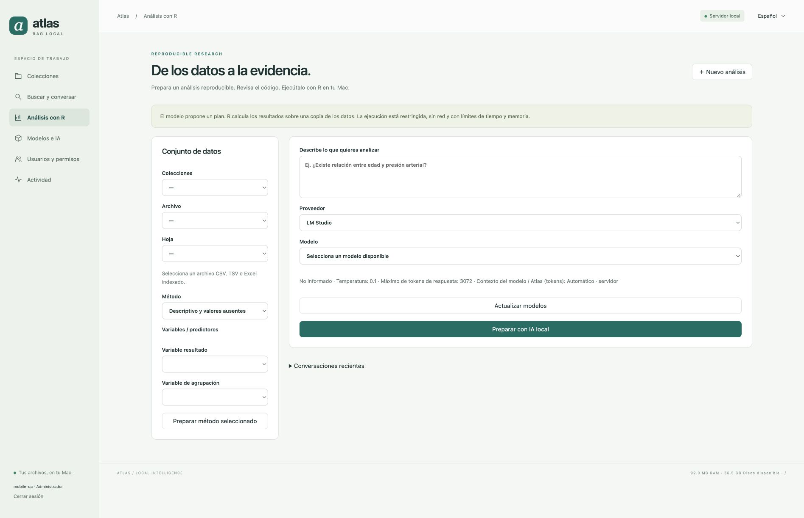
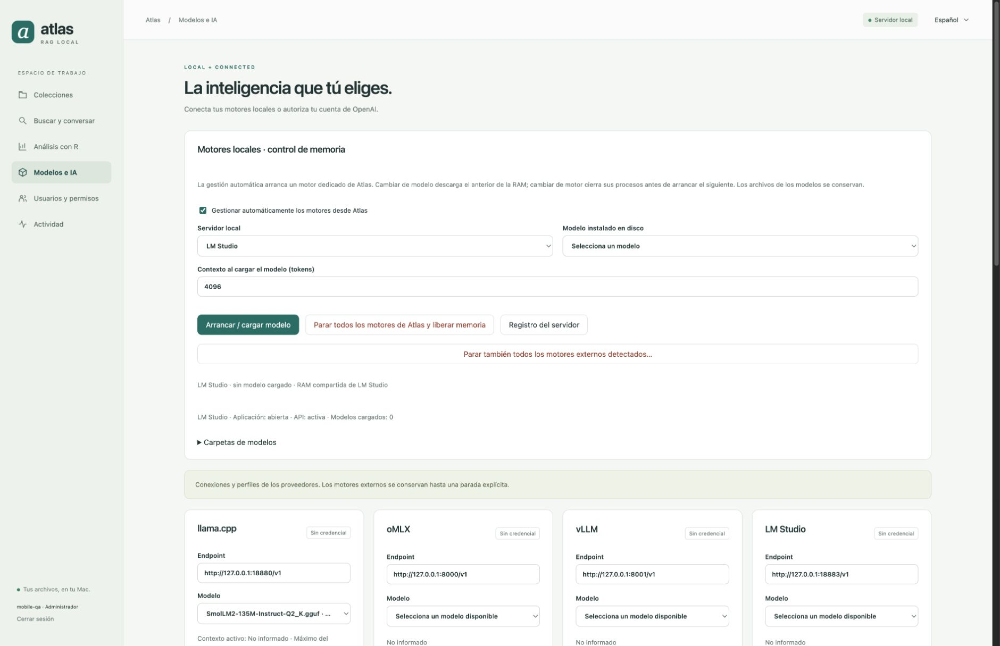
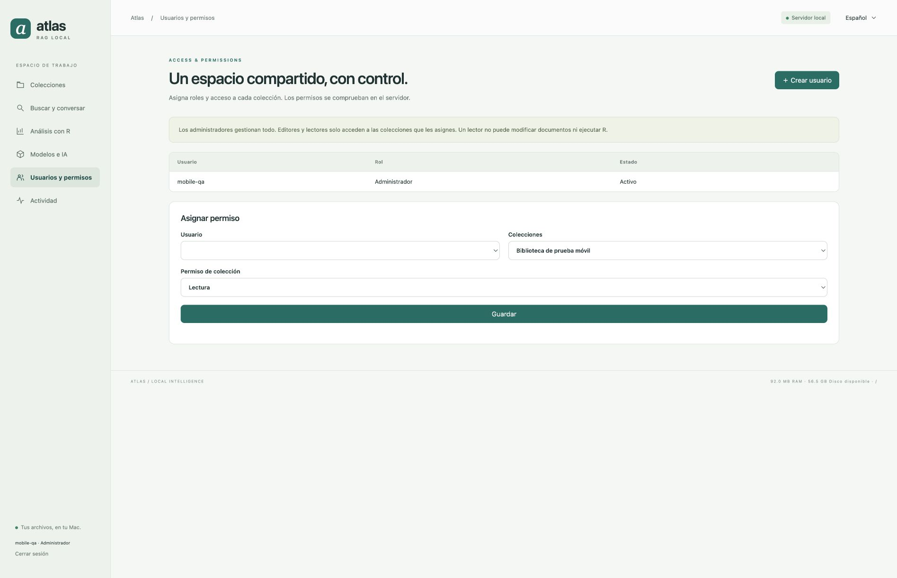
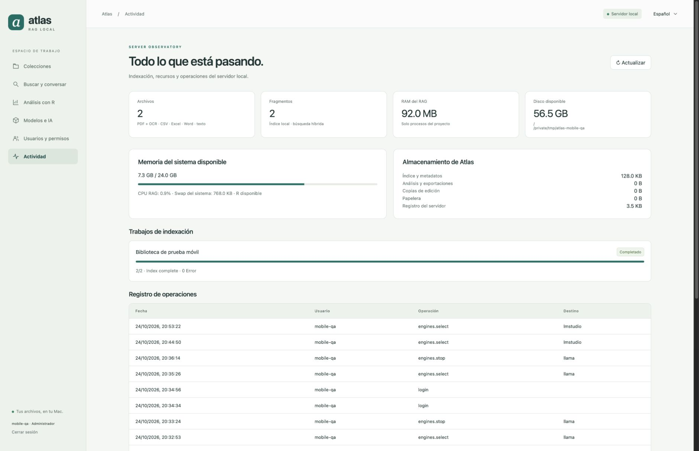

# Atlas RAG Local

**Your documents, models and analyses, on your Mac.**

A local RAG server with a native macOS application and a universal iPhone/iPad client. Organize independent folders, index documents, search with source references and run reproducible analyses with R. The interface supports Spanish and English. Licensed under [Apache 2.0](LICENSE).

[Español](README.md) · [macOS installation](#macos-installation) · [iPhone/iPad](ios/INSTALL.en.md) · [User guide](docs/GUIDE.en.md) · [Project structure](docs/STRUCTURE.en.md)



## Features

- Independent collections with a Mac folder browser and an automatic collection name, including when accessed from an iPad.
- PDF and OCR, CSV, TSV, Excel, Word and text; previews, downloads, text editing and a trash folder that retains a copy.
- Full-text and semantic search, local Apple embeddings, duplicate detection and references to original files.
- llama.cpp, oMLX, vLLM and LM Studio: installed-model catalogs, startup, exclusive model/engine switching and shutdown to release memory.
- OpenAI with your own credential or OAuth for eligible accounts, model and reasoning-level selectors, and consent for each operation.
- Local R: descriptive statistics, correlation, regression, Welch, Wilcoxon, ANOVA and chi-square; reviewable code, results, plots and ZIP exports.
- Administrator, editor and reader roles, collection permissions and an activity log.
- A selectable data directory, with preference for external drives; RAM statistics and free space on the actual data drive.
- Private HTTPS access from iPhone/iPad with pairing and verification of the Mac certificate.

## macOS installation

### Installer

Download the `.dmg` or `.pkg` from [Releases](https://github.com/sruizdeaguiar-svg/Atlas-RAG-Servidor-Local/releases). Drag **Atlas RAG** into Applications from the DMG, or use the PKG to install it in `/Applications`.

The build has been tested on **Apple Silicon with macOS 27**. It uses a development signature and **is not notarized** for general distribution. Distribution trusted by Gatekeeper requires the project maintainer's Developer ID signature and notarization. You can also build from source.

1. Open Atlas and complete **Initial setup**.
2. The wizard detects external drives, proposes a data directory, displays available space and detects R and installed engines. You can choose another directory with the native folder browser.
3. Create the first administrator. You can reopen the wizard from **Server → Initial setup…**.
4. In Collections, select a document folder, save it and choose Index.
5. For local AI, open Models & AI and select an engine and model. For OpenAI, connect your own account on the Mac.

R and AI engines are installed separately; model weights are not bundled. If R is missing, install the Apple Silicon version from [R for macOS](https://mac.r-project.org/), or use `brew install r` if Homebrew is available. The wizard detects both Homebrew R and R.framework.

Application data lives outside the `.app` bundle. The selected data directory contains SQLite, indexes, analyses, backups and logs. OAuth/API credentials and the TLS private key use a private store in the current user's system-drive account, separate from documents. If the selected external drive is unavailable, Atlas reports the problem rather than silently creating another database on the system drive.

### Build from source

You need Xcode/Command Line Tools, Python 3.14, [uv](https://docs.astral.sh/uv/) and R. The scripts use zsh and target Apple Silicon.

```sh
git clone https://github.com/sruizdeaguiar-svg/Atlas-RAG-Servidor-Local.git
cd Atlas-RAG-Servidor-Local
zsh scripts/install.sh
```

`install.sh` installs Python dependencies, installs R through Homebrew when R is missing and Homebrew is available, and builds `~/Applications/Atlas RAG.app`. `scripts/build_app.sh` also creates a Desktop shortcut if that name is unused. It does not download AI models.

To build the installer afterwards:

```sh
zsh scripts/build_installer.sh
```

Artifacts and SHA-256 checksums are written to `dist/`. Without an explicit signing identity, the build uses an available Apple Development identity or an ad hoc signature. Distribution signing and notarization require your own configuration.

## iPhone and iPad

The [`ios/`](ios/) directory contains the Xcode project, SwiftUI source, icons, instructions and an [unsigned device IPA](ios/releases/AtlasRAG-iOS-unsigned.ipa). iOS/iPadOS 17 or later is required.

Sign the app with your own Apple account in Xcode. The unsigned IPA cannot be installed directly. Developer provisioning profiles, private certificates and device identifiers are not published. See the [installation and connection instructions](ios/INSTALL.en.md).

On the Mac, enable **Server → iPhone / iPad · Local network…**. Pair the mobile app using the connection link or QR code, join the same network and sign in with your Atlas account. The database, R and models remain on the Mac.

## Local engines and memory

Automatic engine management is available to administrators. Atlas detects common executable and model directories; you can adjust them in Models & AI. Opening a screen does not load weights. Selecting an engine starts a dedicated instance; vLLM first requires a model selection. Selecting a model loads it without deleting its files.

| Engine | Loading and context | Shutdown |
| --- | --- | --- |
| llama.cpp | Installed GGUF; context set at startup | Terminates the process and its children |
| oMLX | Compatible local model; isolated settings | Unloads and terminates the process |
| vLLM | Installed compatible model; bounded context and KV cache | Terminates the server and its workers |
| LM Studio | Official CLI catalog; load-time context | Unloads the model, stops the API and quits the application |

Only one managed engine remains active. Atlas stops the previous engine before loading another model or switching servers. Temperature, Top-P and maximum output apply per request. Saving a managed profile can reload the context; external servers retain their own configuration.

**Stop all Atlas engines and release memory** stops managed processes. A separate action lists externally started engines and requires confirmation before stopping them. This can interrupt other requests. Neither action deletes model weights or globally purges system caches.

Managed services listen on loopback ports 18880–18883. Atlas does not silently take over an external LM Studio API or its loaded models. The memory estimate is informational by default; an optional preflight block can be enabled in Models & AI; managed context supports 512–32768 tokens. Model compatibility depends on its architecture and the installed engine version.

### Collection embeddings

Add folder has separate embedding-engine and embedding-model selectors. With automatic management enabled, selections made on an iPad are executed on the Mac: the engine starts and loads the model, with loading, ready or error status. Apple uses its built-in language-specific model. The embedding catalog is separate from the chat catalog.

Mixture-of-experts (MoE) models require memory for all weights, plus context and buffers. The preflight reports weight size, estimated requirements and available RAM. Loading is allowed even when the estimate exceeds available RAM unless you enable the optional block. macOS and the engine manage memory and swap.

## Analysis and privacy

AI proposes a plan and R computes on a copy of the data. Code, variables and results remain available for human review. R runs in a macOS sandbox without network access and with time, memory and write limits. The analyst must review the suitability of the method and its assumptions.

Documents and embeddings are processed locally by default. OpenAI operations may send the question and selected context; Atlas requests consent for the operation. No developer credentials are included.

The mobile app requests local-network access, not contacts, photos, microphone, camera or location. The system Camera can read the pairing QR code. Atlas verifies the Mac certificate fingerprint and does not install root certificates. User and collection permissions are enforced on the server.

## Screens

These screenshots use an isolated workspace with fictitious documents. The screenshots show the Spanish interface; the application also offers English.

### Collections

Library, indexing progress, Atlas RAM and free space on the data drive.


### Search and chat

Collection selection, search mode, provider, model and source references.



### R analysis

Dataset, statistical method, variables and preparation of a reproducible analysis.



### Models & AI

Engine lifecycle, shutdown, context, profiles and local/OpenAI connections.



### Users and permissions

Roles and collection access.



### Activity

Server resources, storage, jobs and audit events.



## Verification

Previous releases were checked with security, OAuth, profile, R-isolation, permission and process-control tests; HTTP/HTTPS integration with fictitious documents; real responses from all four engines using small models; and collection creation, indexing and search on a physical iPad. Release notes describe the checks for each delivery; these are not a guarantee that every engine, model or device is supported.

Run unit tests with:

```sh
PYTHONDONTWRITEBYTECODE=1 .venv/bin/python -B -m pytest -q tests/test_*.py
```

R-limit and process tests require normal macOS permissions outside an additional tool sandbox. Integration uses isolated state and ports: review the scripts before running them. Do not run integration tests against a production library.

## Project structure

See the [project tree and data-free package contents](docs/STRUCTURE.en.md).

| Directory | Contents |
| --- | --- |
| `server/` | API, users, documents, RAG, R, OAuth, networking and engines |
| `web/` | Responsive Spanish/English interface |
| `native/` | macOS application and native helpers |
| `ios/` | Universal app, unsigned package and installation instructions |
| `scripts/` | Installation, builds and verification |
| `tests/` | Automated tests |
| `docs/screenshots/` | Public screenshots with fictitious data |

Databases, credentials, model weights, private screenshots, Apple profiles and personal data are excluded from the repository.

## License

[Apache License 2.0](LICENSE). Copyright 2026 sruizdeaguiar-svg and contributors. See [NOTICE](NOTICE). Third-party runtimes, dependencies and models retain their respective licenses.


## Version history

Previous release notes and downloads are indexed on the [historial-versiones branch](https://github.com/sruizdeaguiar-svg/Atlas-RAG-Servidor-Local/tree/historial-versiones). `main` contains current source; each release keeps its tag and Release downloads.

[Security policy and review](SECURITY.md).
